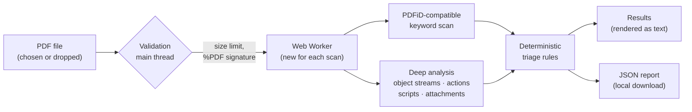

<div align="center">


# PDF Signal

**Inspect suspicious PDFs. Keep your files local.**

A browser-only PDF security triage tool: a verified TypeScript reimplementation of Didier
Stevens' [PDFiD](https://github.com/DidierStevens/DidierStevensSuite/blob/master/pdfid.py), plus a
deep analysis that finds what keyword scanners miss, all running locally in your browser.


</div>

---

## Why

Phishing and malware campaigns still use PDFs that run JavaScript when opened, launch programs,
carry executable attachments or leak Windows credentials through network-share links. Analysts
triage such files with PDFiD, but uploading a suspicious (and often confidential) document to an
online scanner is not always acceptable.

PDF Signal does that triage **entirely in the browser**: no upload, no server, no telemetry. It
explains what it found in plain language, separates raw measurements from interpretation, and
never claims a file is "safe".

> PDF Signal is a static triage tool, not an antivirus product. A finding is a reason to look
> closer, not proof of malware, and a clean result is not proof of safety.

## Features

|                              |                                                                                                                                                                                                                                       |
| ---------------------------- | ------------------------------------------------------------------------------------------------------------------------------------------------------------------------------------------------------------------------------------- |
| 🔍 **PDFiD-compatible scan** | All 20 PDFiD keywords plus `/Colors > 2^24`, hex-escape (obfuscation) counts, header and `%%EOF` checks, entropy, dates and names. Byte-for-byte parity with pdfid.py 0.2.10 on 49 fixtures in two modes.                             |
| 🧬 **Deep analysis**         | Decompresses object streams, where modern PDFs and evasive malware keep their dictionaries, then resolves what `/OpenAction`, `/AA` events, links and document-level scripts actually do.                                             |
| 🧪 **Script inspection**     | Checks JavaScript (including XFA forms and encoded streams) for heap-spray data, shellcode-style escapes, `eval` of decoded data and APIs from known Acrobat exploits, without ever running it.                                       |
| 📎 **Attachments and links** | Flags executable attachments (including `invoice.pdf.exe` and direction-override tricks), archives, macro-capable Office files, network-share links and `javascript:` URLs.                                                           |
| 🚨 **Clear verdicts**        | Five evidence-based levels, from "No configured suspicious indicators detected" to "High-risk indicators detected", each with a "What to do" next step, and a red warning (orange when not high risk) for anything that can run code. |
| 🔒 **Private by design**     | Runs in a Web Worker; strict CSP (`connect-src 'none'`, Trusted Types); no storage, analytics or third-party code.                                                                                                                    |
| 📄 **JSON report**           | Generated locally; contains counts, findings and limitations but never document text, scripts, URLs or file paths.                                                                                                                    |
| ♿ **Accessible**            | Keyboard operable, screen-reader announcements, light and dark themes, responsive down to phone widths, print-friendly results.                                                                                                       |

Try it without a suspicious file of your own: the start page offers three harmless sample PDFs
(clean, auto-running script, script hidden in an object stream) generated in your browser.

## Screenshots

| Start page                                                                                                                    | Clean result                                                                                                                         |
| ----------------------------------------------------------------------------------------------------------------------------- | ------------------------------------------------------------------------------------------------------------------------------------ |
|                    |      |
| **Keyword counts with danger rows**                                                                                           | **Resolved actions and script patterns**                                                                                             |
|  |  |

<p align="center"></p>

## How it works



1. **Validation** checks the size limit and looks for the `%PDF` signature in the first 1024
   bytes, treating the file name and MIME type as untrusted. Files without a signature need an
   explicit "Scan anyway" (PDFiD's `--force`).
2. **The worker** reads the bytes, computes a SHA-256 hash, runs the PDFiD-compatible scan, then
   the deep analysis. Every message back to the page is validated at runtime, and the worker is
   terminated afterwards, which also makes cancellation immediate.
3. **The assessment** applies [documented rules](docs/triage-rules.md) and explains each finding,
   kept separate from the raw counts.

## Quick start

Requires Node.js 22.12 or later.

```sh
git clone <this repository>
cd pdf-signal
npm ci
npm run dev        # http://localhost:5173
```

| Command                                                       | Purpose                                                    |
| ------------------------------------------------------------- | ---------------------------------------------------------- |
| `npm run dev`                                                 | Development server with hot reload                         |
| `npm run build`                                               | Type-check and build the static site into `dist/`          |
| `npm run preview`                                             | Serve the production build locally                         |
| `npm test`                                                    | Run all tests                                              |
| `npm run test:coverage`                                       | Tests with coverage thresholds                             |
| `npm run test:parity`                                         | Compare with the real pdfid.py (set `PDFID_PY`; see below) |
| `npm run lint` / `npm run typecheck` / `npm run format:check` | Static checks                                              |

## What it detects

| Level         | Examples                                                                                                                                                                                                                                                                                |
| ------------- | --------------------------------------------------------------------------------------------------------------------------------------------------------------------------------------------------------------------------------------------------------------------------------------- |
| **High risk** | JavaScript that runs on open (`/OpenAction`, page-open events) · automatic or executable `/Launch` · exploit-style script code · executable attachments · automatic network-share access                                                                                                |
| **Priority**  | Document-level scripts · hex-obfuscated keywords (`/J#61vaScript`) · network-share or `javascript:` links · decompression bombs                                                                                                                                                         |
| **Review**    | `/JS`, `/JavaScript`, `/AA`, `/Launch`, `/EmbeddedFile`, `/RichMedia`, `/XFA`, `/JBIG2Decode` · automatic web or file actions · archives and macro documents · indicators hidden in object streams · structural anomalies (data before the header or after `%%EOF`, unbalanced objects) |
| **Context**   | Forms, object streams, encryption, open actions that only navigate, incremental updates                                                                                                                                                                                                 |

Every level comes with a "What to do" recommendation. Entries that can run code are highlighted
in red when the verdict is high risk and in orange otherwise, so the colours always agree with
the verdict.

The deep analysis is hardened against evasion: it analyses every definition of an object (so
decoys and incremental updates cannot hide the real one), reads encryption only from the
trailer, keeps going past malformed objects, and reports whatever it could not inspect. If it is
defeated, the PDFiD keyword heuristics still apply.

The full rule set, the red-highlighting rules and the differences from PDFiD's triage plugin
are in [docs/triage-rules.md](docs/triage-rules.md).

## Privacy and security

- Files are processed in a Web Worker on your device and **never uploaded**. The production
  Content Security Policy forbids the page from opening any network connection.
- Nothing is written to browser storage. The file is held only while it is needed and released
  when the worker is terminated.
- The PDF is never rendered or executed. Scripts are decoded and pattern-matched as text, then
  discarded; their text, URLs and file names never reach the interface or the report.
- Everything from the file (names, header, dates) and the file name itself is rendered strictly
  as text. There is no `innerHTML`, `eval` or dynamic code anywhere, and Trusted Types enforce
  it in the browser.
- Decompression and parsing are bounded (16 MB per stream, 96 MB in total, 2,000 streams,
  nesting and object limits, a 15-second budget), so decompression bombs and hostile structures
  stop at a limit instead of hanging the tab.

Details: [SECURITY.md](SECURITY.md) (threat model, CSP, GitHub Pages limitations) and
[PRIVACY.md](PRIVACY.md).

## PDFiD compatibility

The keyword engine reproduces pdfid.py 0.2.10's tokenizer exactly, including its quirks (for
example `/JS_x` counts as `/JS`, and keywords inside streams, strings and comments count).
`scripts/pdfid_reference.py` runs the real pdfid.py on every synthetic fixture. Its output is
committed and checked on every test run, and a CI job re-runs it live against the pinned
upstream file (SHA-256 verified):

```sh
mkdir -p .pdfid && curl -fsSL -o .pdfid/pdfid.py \
  https://raw.githubusercontent.com/DidierStevens/DidierStevensSuite/104bb4fe77e24f0891a954af349449227d06f77d/pdfid.py
PDFID_PY="$PWD/.pdfid/pdfid.py" npm run test:parity
```

All 98 comparisons agree; in 5 of them pdfid.py itself crashes on malformed input, which PDF
Signal handles gracefully. The deep analysis never changes these counts. See
[docs/pdfid-compatibility.md](docs/pdfid-compatibility.md) for the source study, the method and
every known difference.

## Testing and quality

- **644 tests** (Vitest + React Testing Library): unit tests for every engine module,
  integration tests through the real worker handler, component and full-flow tests in jsdom,
  and the recorded pdfid.py parity suite.
- Benign synthetic fixtures built byte by byte; no real malware is used or committed.
- Security tests: hostile file names and PDF names rendered as text, no network requests or
  storage during a full scan, protocol violations, cancellation, timeouts, decompression bombs,
  randomized hostile input, and no document content in results or reports.
- Static invariants fail the build on network or storage APIs, HTML injection sinks, `eval`,
  embedded viewers, inline styles, remote URLs, a weakened CSP, extra runtime dependencies or
  hidden Unicode (Trojan Source) characters.
- Coverage thresholds for the engine and assessment (≥ 90 % lines, ≥ 85 % branches); strict
  TypeScript (`noUncheckedIndexedAccess`, `exactOptionalPropertyTypes`); type-aware ESLint with
  zero warnings.
- The production build was verified in Chrome with the full CSP and Trusted Types enabled.

## Project structure

```text
src/
├── app/                        App shell and styles
├── components/                 layout · upload (drop zone, samples) · scanner · results · icons
├── features/
│   ├── pdf-analysis/
│   │   ├── engine/             PDFiD-compatible scan · deep analysis (objects, filters, scripts)
│   │   ├── worker/             Web Worker, message protocol and client
│   │   ├── assessment/         triage rules and explanations
│   │   ├── validation/         file checks and name sanitizing
│   │   ├── reports/            JSON report export
│   │   └── hooks/              upload → scan → assess workflow
│   └── samples/                harmless sample PDFs generated in the browser
├── security/                   Trusted Types policy
└── styles/                     design tokens, global and accessibility styles
tests/                          unit · integration · components · parity · fixtures
scripts/pdfid_reference.py      runs pdfid.py for the parity tests
docs/                           PDFiD study, triage rules, screenshots
```

## Deploying

The build is a static site with a relative base path, so `dist/` works at
`https://<user>.github.io/<repository>/`, at a domain root or in any subfolder.

1. In **Settings → Pages**, set **Source** to **GitHub Actions**. (GitHub Pages for private
   repositories requires a paid plan; public repositories are free.)
2. Run the **Deploy to GitHub Pages** workflow manually, or set the repository variable
   `PAGES_ENABLED` to `true` to deploy on every push to `main`.

No secrets are needed. GitHub Pages cannot send custom security headers, so the CSP is delivered
by a `<meta>` element; see SECURITY.md for the consequences. Any other static host works too.

## Limitations

- Encrypted PDFs are not decrypted, so their compressed objects and scripts cannot be inspected.
- FlateDecode, ASCIIHex, ASCII85 and RunLength streams are decoded; LZW content is not.
- Script analysis is static pattern matching; heavily obfuscated code may show no known pattern.
- Files are limited to 10 MB and scans to 30 seconds; very large documents are analysed
  partially and say so.

## Roadmap

- Decryption of documents protected only by an empty user password.
- Recursive scanning of attached PDFs.
- Batch triage of several files with a combined report.

## Credits and licence

PDF Signal is released under the [MIT licence](LICENSE). It is an independent implementation
inspired by, and verified against, [PDFiD](https://blog.didierstevens.com/programs/pdf-tools/)
by Didier Stevens, whose source code is in the public domain. No pdfid.py code is included, and
PDF Signal is not affiliated with or endorsed by its author.
